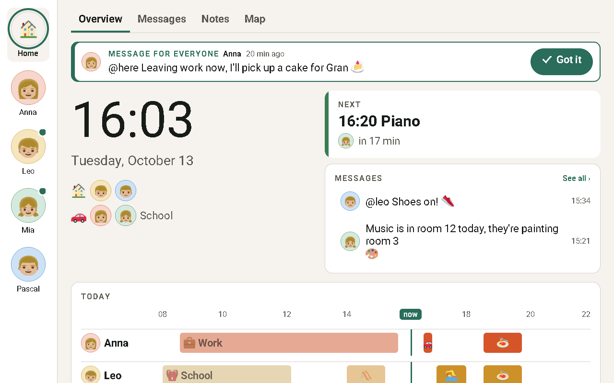
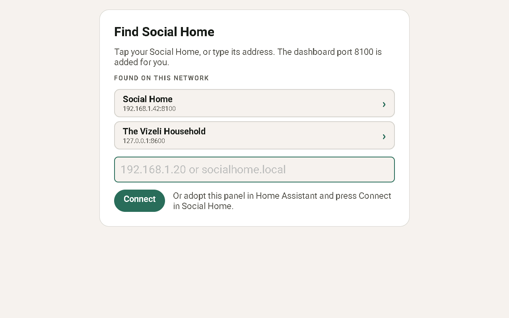

# Social Home ESPHome dashboard

Firmware that turns an ESPHome touch panel into a [Social Home](https://github.com/social-home-io/socialhome)
wall dashboard: the same household view as the browser dashboard, on a panel
on the wall.

> **Status: ready for the first release.** The panel finds Social Home on the
> home network (or by typed address, or through Home Assistant's **Connect**),
> pairs with the household and shows the household dashboard: Overview,
> Messages (with a count of new ones on the tab), Notes, Map ("Who's where")
> with the map picture, each person's page and the picture view for children,
> the night screen and the privacy lock with its PIN pad, and "Got it" on
> mentions, in the household's language. It joins Wi-Fi through Improv, works
> as a Home Assistant Bluetooth proxy and updates itself over the air. It needs
> Social Home with the wall panel API (display API v1).



## Supported panels

| Panel | Chip | Screen | Bluetooth proxy |
|---|---|---|---|
| Guition JC8012P4A1 (10.1") | ESP32-P4 + ESP32-C6 | 1280×800 (landscape) | yes |

The firmware is built for the panel's engineering-sample ESP32-P4 silicon
(pre-v3.0, `engineering_sample: "true"` in
[`devices/guition-jc8012p4a1/packages.yaml`](devices/guition-jc8012p4a1/packages.yaml)).
A board with v3.0 or later silicon needs that set to `"false"` and its own
build. The catalogue lives in
[`devices/manifest.json`](devices/manifest.json).

## Install

1. Open the [web installer](https://social-home-io.github.io/esphome-dashboard/)
   in Chrome or Edge on a desktop computer. It always installs the latest
   release (the factory image; it offers to erase the panel first).
2. Plug the panel in with USB-C, pick it, press **Install**.
3. After flashing, the installer asks for your Wi-Fi (Improv over serial).

Other ways to set Wi-Fi:

- **Improv over Bluetooth:** Home Assistant discovers the panel, or use
  [improv-wifi.com](https://www.improv-wifi.com/) from a phone. The panel asks
  you to tap **Allow** before it accepts credentials.
- **Captive portal (fallback):** without Wi-Fi the panel opens a
  `socialhome-dashboard-xxxxxx` access point after about a minute.

### Connect to Social Home

1. Once on Wi-Fi the panel looks for Social Home on your network and lists
   what it finds under **Found on this network**: tap yours. Not listed (the
   Home Assistant App doesn't announce itself, and some networks block
   mDNS)? Type its IP or host name; the dashboard port 8100 is added for
   you.

   
2. The panel shows a six-character code. In Social Home open
   **Admin › Dashboard › Wall panels › Add** and enter it.
3. The panel shows the dashboard. It polls every 30 seconds (and only
   downloads what changed).

Or let Home Assistant do it: adopt the panel in Home Assistant, then press
**Connect** for it in Social Home. Social Home finds the panel through Home
Assistant and calls the panel's `connect_social_home` action with one
variable, `sealed`: its address and a one-time claim (valid ten minutes, used
once), sealed to the panel's own key. Home Assistant's recorder keeps every
action's data, so all it ever stores is ciphertext and the panel's public
key, never the claim or the address. The panel opens it, trades the claim for
its token and proves it holds the key Social Home sealed to (header
`X-Display-Key`), no code needed. Connecting a panel that is already paired
moves it to the new pairing; if the connect fails (or the request can't be
opened on this panel), a paired panel keeps its old pairing.

The key is an X25519 keypair the panel makes on first boot and keeps in its
flash; only the public half leaves the panel. **Forget server** makes a new
one, and so does a factory reset (it wipes the stored settings), so a
connect request sealed to the old key no longer opens: press Connect in
Social Home again.

Hold the clock for five seconds to open the panel's settings: the server, the
panel id, the firmware, the licences, and **Forget server** to start over.
Removing the panel in Social Home sends it back to the pairing code.

### Home Assistant

Home Assistant finds the panel through ESPHome. Adopting it is optional: the
dashboard works without Home Assistant, and the native API never reboots the
panel when nothing connects. Once adopted, the panel also extends Home
Assistant's Bluetooth range (active Bluetooth proxy), offers the
`connect_social_home` action Social Home uses to connect it (see above) and
reports four text sensors: **Social Home status** (`unpaired`, `pairing`,
`paired`, `locked` or `unreachable`), **Social Home node** (diagnostic: the
ESPHome node name, which Social Home reads to call the action), **Social
Home key** (diagnostic: the panel's public key, 43 characters of base64url,
which Social Home seals the connect claim to) and **Social Home HA unlock**
(diagnostic: `allowed` or `off`; keeps its last value while unpaired).
Social Home finds the node and key sensors by these exact names.

The **Privacy lock** entity locks the panel as its lock button does (the
household needs a PIN) and shows its lock wherever it came from: the PIN
pad, an admin in Social Home or Home Assistant. Unlocking it from Home
Assistant skips the PIN, so it only works once an admin turns on **Home
Assistant may unlock wall panels** in Social Home (Admin › Dashboard › Wall
panels); otherwise the panel stays locked and logs why. The lock reads
*jammed* while the panel can't lock: not paired, pairing, needing an update
or unable to reach Social Home.

To build it yourself from the ESPHome dashboard, adopt the panel or start from
[`devices/guition-jc8012p4a1/esphome.yaml`](devices/guition-jc8012p4a1/esphome.yaml),
which pulls everything else from this repository.

### Updates

Releases publish firmware and an update manifest on GitHub Pages; the
installer site always serves the latest stable release. The panel
exposes a **Firmware** update entity (and a **Co-processor firmware** entity
for the ESP32-C6 radio) that installs over the air.

## Repository layout

```
devices/manifest.json          device catalogue (drives the CI matrix)
devices/<slug>/esphome.yaml    user-adoptable config (remote packages)
devices/<slug>/packages.yaml   substitutions (screen size, fonts) + package list
devices/<slug>/device/         hardware: display, touch, radio, backlight, fonts
common/                        shared packages: network, API, OTA, update,
                               Improv, Bluetooth proxy, backlight, time
components/socialhome_display/ the dashboard (ESPHome external component)
builds/<slug>[.factory].yaml   CI and release entry points
docs/                          GitHub Pages web installer
scripts/                       CI helpers (device matrix, update manifest, Pages site)
tests/                         script tests, host C++ tests (tests/cpp) and the
                               pinned display API contract (tests/fixtures)
builds/host-sdl.yaml           the app in a headless SDL window, for screenshots
```

## The app

`components/socialhome_display` is plain C++ on ESPHome's LVGL:

- `parser.*` / `model.h`: the Social Home display API v1 (`/api/display/v1/`)
  parsed with ArduinoJson into structs. Unknown fields are ignored; an
  `api_version` other than 1 shows "This panel needs an update".
- `net.*`: HTTP on a worker thread (`esp_http_client` on the panel,
  cpp-httplib on the host build) with ETag revalidation; avatars and emoji are
  decoded (pngle) into ARGB8888 off the main loop.
- `images.*`: a small PSRAM LRU cache of those pictures.
- `socialhome_display.cpp`: setup → pairing (a code, or Connect from Home
  Assistant via `POST /pair/claim`) → polling, every status code the
  API documents (401 pair again, 404/409 back to Overview, 423 lock screen,
  429 Retry-After), clock, idle return, night dimming, screen-off timeout.
- `ui_*.cpp`: the screens, laid out from the 1280×800 browser dashboard and
  scaled from `screen_width` / `screen_height` / `ui_scale`.
- `panel_strings.*` / `theme_cache.*`: the words the panel draws itself and
  the last theme kept across reboots.

The privacy lock screen is the wall tablet's, element for element: household
name, the clock (160 px; 96 px with the PIN pad open), the date and a "🔒 PIN"
button; the pad shows the tablet's alert ("Wrong PIN" with "Tries left: n", or
the last-try warning), "Enter PIN", the typed dots, a 4–6 digit keypad and
"Forgot the PIN?" — and closes after a quiet minute, as on the tablet.

Every string a person reads comes from the server in the household's language:
the boards carry their own words, and the theme (`GET /theme`) carries the
panel's — setup, pairing, errors, the PIN pad, settings, the Improv prompt.
The panel keeps the last theme's language, colours and those strings in flash,
so after a reboot or "Forget server" the setup screens still speak the
household's language before any server answers. Its built-in English is only
for a panel that never reached a server (and for a server older than the one
pinned in `tests/fixtures/display-api/SOURCE`). Emoji are pictures (Twemoji, CC-BY 4.0) from the server, as the
fonts carry none.

The panel picks its palette as the browser dashboard does. In the household's
night window the night screen — and the dashboard someone wakes from it, which
hides its tabs and "See all" links like the browser — always uses the night
palette, whatever the colour mode. So does the privacy lock screen while its
423 body says `is_night` (the backlight dims too; an open PIN pad lights it
up). Everything else (the lock screen by day, settings, setup and error
screens) follows the theme's colour mode:
**Light** and **Dark** stay as they are, day and night; **Auto** has no system
setting to follow on a panel, so it is light by day and dark during the night
window. "Night" is the server's `is_night` flag on each board — the same flag
that brings up the night screen and dims the backlight, computed from the
board settings' night start / end on the household's clock — so the panel and
the browser switch together, at the next poll, without a reboot. While the
panel is locked or can't reach the server it keeps the last board's flag;
before the first board (setup, first boot) it is day.

## Development

```sh
python3 -m venv .venv
.venv/bin/pip install "esphome==$(sed -n 's/^ESPHOME_VERSION=//p' .github/esphome.env)" yamllint
.venv/bin/esphome config builds/guition-jc8012p4a1.factory.yaml
.venv/bin/esphome compile builds/guition-jc8012p4a1.factory.yaml
.venv/bin/esphome run builds/guition-jc8012p4a1.factory.yaml   # flash over USB
```

Host tests (parser against the pinned fixtures, layout maths):

```sh
cmake -S tests/cpp -B build/tests && cmake --build build/tests && ctest --test-dir build/tests
```

Screenshots without hardware (needs `libsdl2-dev`, `libssl-dev` and
`libmbedtls-dev`): build
`builds/host-sdl.yaml`, run the binary, and drive it through its command file
(see `builds/host/host_driver.h`; each panel has its own, logged at start-up
— [tests/README.md](tests/README.md)). It writes BMPs to
`builds/.esphome/snapshots/socialhome-host/` (or `$ESPHOME_SNAPSHOT_DIR`). The host build has no mDNS: to
see the **Found on this network** list, pass a fixed one, e.g.
`-s discovery_stub "Social Home 1a2b3c|socialhome-1a2b3c|127.0.0.1|8100|api=1,id=1a2b3c"`.

CI compiles every device on each pull request and uploads the factory and OTA
images as build artifacts, so a PR build can be flashed for testing. See
[CONTRIBUTING.md](CONTRIBUTING.md) to add a panel.

Releases use CalVer tags (`YYYY.M.D[.N]`, no `v` prefix). Every merge to
`main` refreshes a **draft release** named after the next tag, with notes
generated from the merged PRs (grouped by label; `release-draft.yml`).
Publishing that draft creates the tag and builds every device, attaches the
images to the release and deploys the web installer plus update manifests to
GitHub Pages (`release.yml`). Publish it as a pre-release to keep panels on
the wall from being offered it.

The web installer also deploys on every merge to `main` (`pages.yml`), so a
change to `docs/` is live right after it merges. Pages keeps one site per
repository and each deploy replaces all of it, so every deploy is built the
same way by `scripts/build_site.py`: `docs/` from `main` plus the firmware and
update manifests of the **latest published, non-pre-release release**. A merge
never changes the firmware panels are offered, and a release deploys exactly
what the next merge would. Before the first release the site shows a
"No firmware release yet" state instead of install buttons. While a release is
still building (its images aren't attached yet), a merge leaves the live site
alone; the release's own deploy follows once the images are attached.

## License

- The sources in this repository (YAML, C++, Python, web installer) are
  licensed under the [Mozilla Public License 2.0](LICENSE).
- The **compiled firmware** links ESPHome, whose C++ runtime is GPLv3, so the
  binaries attached to releases and served by the web installer are
  distributed under the **GNU GPL v3**. The sources to rebuild them are this
  repository at the release tag plus the pinned ESPHome release
  (`.github/esphome.env`). It also contains LVGL (MIT) and Mbed TLS
  (Apache-2.0, part of ESP-IDF).
- **Emoji** are [Twemoji](https://github.com/jdecked/twemoji) graphics
  (© Twitter, Inc and other contributors, © jdecked and other contributors),
  licensed [CC-BY 4.0](https://creativecommons.org/licenses/by/4.0/). Social
  Home bundles and serves them; the panel only draws them. Attribution is on
  the panel's settings screen and in [NOTICE](NOTICE).
- **Roboto** is downloaded from Google Fonts at build time and embedded in the
  firmware, licensed under the [SIL Open Font License 1.1](https://openfontlicense.org).
- The touch controller firmware blob is downloaded at build time from
  [esphome-libs/gsl3670-firmware](https://github.com/esphome-libs/gsl3670-firmware)
  (Apache-2.0).
